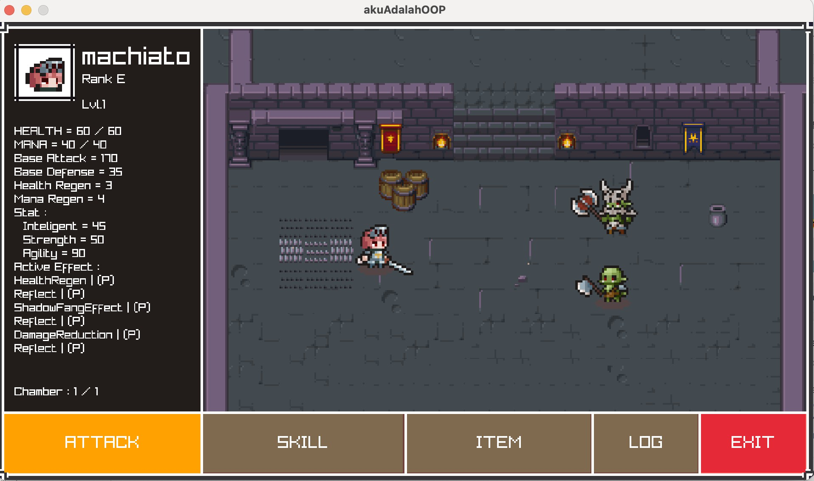

<h1 align="center">Tugas Besar 1 IF2010 Pemrograman Berorientasi Objek</h1>
<h2 align="center">Semester II tahun 2024/2025</h2>
<h1 align="center">Purry Leveling</h1>

<p align="center">
  
</p>

## Table of Contents

- [Description](#description)
- [Program Structure](#program-structure)
- [Requirements & Installation](#requirements--installation)
- [How to Use](#how-to-use)
- [Contributors](#contributors)
- [References](#references)

## Description

Purry Leveling is a GUI-based, turn-based dungeon RPG developed as a project for an Object-Oriented Programming course. Players assume the role of OWCA agents exploring procedurally generated dungeons to defeat monsters, collect loot, and stop the villain Cyborg. The game includes a user-friendly interface with interactive buttons, visual feedback, and dynamic sound effects triggered during gameplay events like attacking, using skills, or equipping items. As players venture deeper into the dungeon, they may encounter unexpected surprises that add charm and unpredictability to the journey.

Players can choose from several unique character classes, each with their own attributes and skill trees. The game features various dungeon difficulty levels, challenging boss fights, a turn-based battle system, and a shop for purchasing and equipping items. Inventory management and game progress saving/loading are handled through GUI elements for ease of use.

## Program Structure

```
├── Assets
├── bin
├── data
├── include
├── obj
├── raylib
└── src
```

**include structure**

```
include
├── lib
│   ├── Dungeon
│   │   ├── Dungeon.hpp
│   │   ├── DungeonRankA
│   │   │   └── DungeonRankA.hpp
│   │   ├── DungeonRankB
│   │   │   └── DungeonRankB.hpp
│   │   ├── DungeonRankC
│   │   │   └── DungeonRankC.hpp
│   │   ├── DungeonRankD
│   │   │   └── DungeonRankD.hpp
│   │   ├── DungeonRankE
│   │   │   └── DungeonRankE.hpp
│   │   ├── DungeonRankS
│   │   │   └── DungeonRankS.hpp
│   │   └── DungeonSpecial
│   │       └── DungeonSpecial.hpp
│   ├── Effect
│   │   ├── Effect.hpp
│   │   ├── ItemEffect
│   │   │   ├── CrimsonCurseEffect
│   │   │   │   └── CrimsonCurseEffect.hpp
│   │   │   ├── DamageReductionEffect
│   │   │   │   └── DamageReductionEffect.hpp
│   │   │   ├── DullingCurseEffect
│   │   │   │   └── DullingCurseEffect.hpp
│   │   │   ├── HealthRegenEffect
│   │   │   │   └── HealthRegenEffect.hpp
│   │   │   ├── ItemEffect.hpp
│   │   │   ├── ManaRegenEffect
│   │   │   │   └── ManaRegenEffect.hpp
│   │   │   ├── ReflectEffect
│   │   │   │   └── ReflectEffect.hpp
│   │   │   ├── ShadowFangEffect
│   │   │   │   └── ShadowFangEffect.hpp
│   │   │   ├── ShatterArmorEffect
│   │   │   │   └── ShatterArmorEffect.hpp
│   │   │   └── SpeedBoostEffect
│   │   │       └── SpeedBoostEffect.hpp
│   │   └── SkillEffect
│   │       ├── BrittleEffect
│   │       │   └── BrittleEffect.hpp
│   │       ├── BurnEffect
│   │       │   └── BurnEffect.hpp
│   │       ├── CriticalDamageEffect
│   │       │   └── CriticalDamageEffect.hpp
│   │       ├── DecayEffect
│   │       │   └── DecayEffect.hpp
│   │       ├── HealEffect
│   │       │   └── HealEffect.hpp
│   │       ├── HealthDrainEffect
│   │       │   └── HealthDrainEffect.hpp
│   │       ├── ManaDrainEffect
│   │       │   └── ManaDrainEffect.hpp
│   │       ├── RageEffect
│   │       │   └── RageEffect.hpp
│   │       ├── SkillEffect.hpp
│   │       ├── SlowEffect
│   │       │   └── SlowEffect.hpp
│   │       ├── StatReductionEffect
│   │       │   └── StatReductionEffect.hpp
│   │       ├── StunEffect
│   │       │   └── StunEffect.hpp
│   │       └── WeakenEffect
│   │           └── WeakenEffect.hpp
│   ├── GameState
│   │   └── GameState.hpp
│   ├── GUI
│   │   ├── Animation
│   │   │   └── Animation.hpp
│   │   ├── Button
│   │   │   └── Button.hpp
│   │   ├── CharAnimation
│   │   │   └── CharAnimation.hpp
│   │   ├── GUI.hpp
│   │   ├── PopUp
│   │   │   └── PopUp.hpp
│   │   ├── Screen
│   │   │   ├── CharacterSelectionScreen
│   │   │   │   └── CharacterSelectionScreen.hpp
│   │   │   ├── DungeonScreen
│   │   │   │   └── DungeonScreen.hpp
│   │   │   ├── DungeonSelectionScreen
│   │   │   │   └── DungeonSelectionScreen.hpp
│   │   │   ├── EndDungeonScreen
│   │   │   │   └── EndDungeonScreen.hpp
│   │   │   ├── ExitScreen
│   │   │   │   └── ExitScreen.hpp
│   │   │   ├── HomeScreen
│   │   │   │   └── HomeScreen.hpp
│   │   │   ├── InfoScreen
│   │   │   │   └── InfoScreen.hpp
│   │   │   ├── InventoryScreen
│   │   │   │   └── InventoryScreen.hpp
│   │   │   ├── LoadScreen
│   │   │   │   └── LoadScreen.hpp
│   │   │   ├── SaveScreen
│   │   │   │   └── SaveScreen.hpp
│   │   │   ├── Screen.hpp
│   │   │   ├── ShopScreen
│   │   │   │   └── ShopScreen.hpp
│   │   │   ├── SkillPathScreen
│   │   │   │   └── SkillPathScreen.hpp
│   │   │   └── StartScreen
│   │   │       └── StartScreen.hpp
│   │   └── TextInput
│   │       └── TextInput.hpp
│   ├── Inventory
│   │   ├── Inventory.hpp
│   │   └── Slot.hpp
│   ├── IO
│   │   └── IO.hpp
│   ├── Item
│   │   ├── Armor
│   │   │   └── Armor.hpp
│   │   ├── Item.hpp
│   │   ├── Pendant
│   │   │   └── Pendant.hpp
│   │   ├── Potion
│   │   │   └── Potion.hpp
│   │   └── Weapon
│   │       └── Weapon.hpp
│   ├── Rarity
│   │   └── Rarity.hpp
│   ├── Shop
│   │   ├── Shop.hpp
│   │   └── ShopItem.hpp
│   ├── Skill
│   │   └── Skill.hpp
│   ├── SkillTree
│   │   └── SkillTree.hpp
│   └── Unit
│       ├── Character
│       │   ├── Assasin
│       │   │   └── Assasin.hpp
│       │   ├── Berserker
│       │   │   └── Berserker.hpp
│       │   ├── Character.hpp
│       │   ├── Fighter
│       │   │   └── Fighter.hpp
│       │   ├── Mage
│       │   │   └── Mage.hpp
│       │   └── Necromancer
│       │       └── Necromancer.hpp
│       ├── Mob
│       │   ├── BasicMob
│       │   │   ├── BasicMob.hpp
│       │   │   ├── Goblin
│       │   │   │   └── Goblin.hpp
│       │   │   ├── Orc
│       │   │   │   └── Orc.hpp
│       │   │   ├── Skeleton
│       │   │   │   └── Skeleton.hpp
│       │   │   └── Slime
│       │   │       └── Slime.hpp
│       │   ├── BossMob
│       │   │   ├── BossMob.hpp
│       │   │   ├── DarkKnight
│       │   │   │   └── DarkKnight.hpp
│       │   │   ├── DemonLord
│       │   │   │   └── DemonLord.hpp
│       │   │   ├── Lich
│       │   │   │   └── Lich.hpp
│       │   │   └── Ogre
│       │   │       └── Ogre.hpp
│       │   └── Mob.hpp
│       └── Unit.hpp
└── raylib.h
```

**src structure**

```
src
├── lib
│   ├── Dungeon
│   │   ├── Dungeon.cpp
│   │   ├── DungeonRankA
│   │   │   └── DungeonRankA.cpp
│   │   ├── DungeonRankB
│   │   │   └── DungeonRankB.cpp
│   │   ├── DungeonRankC
│   │   │   └── DungeonRankC.cpp
│   │   ├── DungeonRankD
│   │   │   └── DungeonRankD.cpp
│   │   ├── DungeonRankE
│   │   │   └── DungeonRankE.cpp
│   │   ├── DungeonRankS
│   │   │   └── DungeonRankS.cpp
│   │   └── DungeonSpecial
│   │       └── DungeonSpecial.cpp
│   ├── Effect
│   │   ├── Effect.cpp
│   │   ├── ItemEffect
│   │   │   ├── CrimsonCurseEffect
│   │   │   │   └── CrimsonCurseEffect.cpp
│   │   │   ├── DamageReductionEffect
│   │   │   │   └── DamageReductionEffect.cpp
│   │   │   ├── DullingCurseEffect
│   │   │   │   └── DullingCurseEffect.cpp
│   │   │   ├── HealthRegenEffect
│   │   │   │   └── HealthRegenEffect.cpp
│   │   │   ├── ItemEffect.cpp
│   │   │   ├── ManaRegenEffect
│   │   │   │   └── ManaRegenEffect.cpp
│   │   │   ├── ReflectEffect
│   │   │   │   └── ReflectEffect.cpp
│   │   │   ├── ShadowFangEffect
│   │   │   │   └── ShadowFangEffect.cpp
│   │   │   ├── ShatterArmorEffect
│   │   │   │   └── ShatterArmorEffec.t.cpp
│   │   │   └── SpeedBoostEffect
│   │   │       └── SpeedBoostEffect.cpp
│   │   └── SkillEffect
│   │       ├── BrittleEffect
│   │       │   └── BrittleEffect.cpp
│   │       ├── BurnEffect
│   │       │   └── BurnEffect.cpp
│   │       ├── CriticalDamageEffect
│   │       │   └── CriticalDamageEffect.cpp
│   │       ├── DecayEffect
│   │       │   └── DecayEffect.cpp
│   │       ├── HealEffect
│   │       │   └── HealEffect.cpp
│   │       ├── HealthDrainEffect
│   │       │   └── HealthDrainEffect.cpp
│   │       ├── ManaDrainEffect
│   │       │   └── ManaDrainEffect.cpp
│   │       ├── RageEffect
│   │       │   └── RageEffect.cpp
│   │       ├── SkillEffect.cpp
│   │       ├── SlowEffect
│   │       │   └── SlowEffect.cpp
│   │       ├── StatReductionEffect
│   │       │   └── StatReductionEffect.cpp
│   │       ├── StunEffect
│   │       │   └── StunEffect.cpp
│   │       └── WeakenEffect
│   │           └── WeakenEffect.cpp
│   ├── GameState
│   │   └── GameState.cpp
│   ├── GUI
│   │   ├── Animation
│   │   │   └── Animation.cpp
│   │   ├── Button
│   │   │   └── Button.cpp
│   │   ├── CharAnimation
│   │   │   └── CharAnimation.cpp
│   │   ├── GUI.cpp
│   │   ├── PopUp
│   │   │   └── PopUp.cpp
│   │   ├── Screen
│   │   │   ├── CharacterSelectionScreen
│   │   │   │   └── CharacterSelectionScreen.cpp
│   │   │   ├── DungeonScreen
│   │   │   │   └── DungeonScreen.cpp
│   │   │   ├── DungeonSelectionScreen
│   │   │   │   └── DungeonSelectionScreen.cpp
│   │   │   ├── EndDungeonScreen
│   │   │   │   └── EndDungeonScreen.cpp
│   │   │   ├── ExitScreen
│   │   │   │   └── ExitScreen.cpp
│   │   │   ├── HomeScreen
│   │   │   │   └── HomeScreen.cpp
│   │   │   ├── InfoScreen
│   │   │   │   └── InfoScreen.cpp
│   │   │   ├── InventoryScreen
│   │   │   │   └── InventoryScreen.cpp
│   │   │   ├── LoadScreen
│   │   │   │   └── LoadScreen.cpp
│   │   │   ├── SaveScreen
│   │   │   │   └── SaveScreen.cpp
│   │   │   ├── Screen.cpp
│   │   │   ├── ShopScreen
│   │   │   │   └── ShopScreen.cpp
│   │   │   ├── SkillPathScreen
│   │   │   │   └── SkillPathScreen.cpp
│   │   │   └── StartScreen
│   │   │       └── StartScreen.cpp
│   │   └── TextInput
│   │       └── TextInput.cpp
│   ├── Inventory
│   │   ├── Inventory.cpp
│   │   └── Slot.cpp
│   ├── IO
│   │   └── IO.cpp
│   ├── Item
│   │   ├── Armor
│   │   │   └── Armor.cpp
│   │   ├── Item.cpp
│   │   ├── Pendant
│   │   │   └── Pendant.cpp
│   │   ├── Potion
│   │   │   └── Potion.cpp
│   │   └── Weapon
│   │       └── Weapon.cpp
│   ├── Rarity
│   │   └── Rarity.cpp
│   ├── Shop
│   │   ├── Shop.cpp
│   │   └── ShopItem.cpp
│   ├── Skill
│   │   └── Skill.cpp
│   ├── SkillTree
│   │   └── SkillTree.cpp
│   └── Unit
│       ├── Character
│       │   ├── Assasin
│       │   │   └── Assasin.cpp
│       │   ├── Berserker
│       │   │   └── Berserker.cpp
│       │   ├── Character.cpp
│       │   ├── Fighter
│       │   │   └── Fighter.cpp
│       │   ├── Mage
│       │   │   └── Mage.cpp
│       │   └── Necromancer
│       │       └── Necromancer.cpp
│       ├── Mob
│       │   ├── BasicMob
│       │   │   ├── BasicMob.cpp
│       │   │   ├── Goblin
│       │   │   │   └── Goblin.cpp
│       │   │   ├── Orc
│       │   │   │   └── Orc.cpp
│       │   │   ├── Skeleton
│       │   │   │   └── Skeleton.cpp
│       │   │   └── Slime
│       │   │       └── Slime.cpp
│       │   ├── BossMob
│       │   │   ├── BossMob.cpp
│       │   │   ├── DarkKnight
│       │   │   │   └── DarkKnight.cpp
│       │   │   ├── DemonLord
│       │   │   │   └── DemonLord.cpp
│       │   │   ├── Lich
│       │   │   │   └── Lich.cpp
│       │   │   └── Ogre
│       │   │       └── Ogre.cpp
│       │   └── Mob.cpp
│       └── Unit.cpp
└── main.cpp
```

## Requirements & Installation

1. Clone the repository
   ```bash
   git clone https://github.com/Labpro-21/if2010-2425-tubes-1-rpl.git
   ```
2. Navigate to project directory
   ```bash
   cd if2010-2425-tubes-1-rpl
   ```
3. Install Raylib (if not already installed)
   ```bash
   make raylib
   ```

## Other ways to install raylib on linux

```bash
sudo apt update
sudo apt install -y build-essential cmake git \
  libgl1-mesa-dev libx11-dev libxcursor-dev libxrandr-dev \
  libxi-dev libxinerama-dev libxxf86vm-dev \
  libopenal-dev libasound2-dev libpulse-dev \
  libvorbis-dev libdrm-dev

git clone https://github.com/raysan5/raylib.git
cd raylib
mkdir build && cd build
cmake -DBUILD_SHARED_LIBS=ON ..
make -j$(nproc)
sudo make install
```

## Raylib Website

https://www.raylib.com

## How To Run

1. Run the Game
   ```bash
   make run
   ```
2. The game will launch with a graphical user interface (GUI).

You can view a demo video of the game at the following link:

[](https://youtu.be/YeTsRwMcIo8)

## Clean Up

To remove all compiled binaries and reset the build, use:

```bash
make clean
```

## Contributors

| **NIM**  | **Nama Anggota**            | **Github**                                        |
| -------- | --------------------------- | ------------------------------------------------- |
| 13523073 | Alfian Hanif F. Y           | [AlfianHanifFY](https://github.com/AlfianHanifFY) |
| 13523091 | Carlo Angkisan              | [carllix](https://github.com/carllix)             |
| 13523107 | Heleni Gratia M. Tampubolon | [mineraleee](https://github.com/mineraleee)       |
| 13523121 | Ahmad Wicaksono             | [sonix03](https://github.com/sonix03)             |

## References

[Spesifikasi Tubes 1: Purry Leveling](https://docs.google.com/document/d/1K4iKqT2yirDq1P0gRQ2UjhrGpHzR1DUIMNqVMqYAFsY/edit?usp=sharing)
